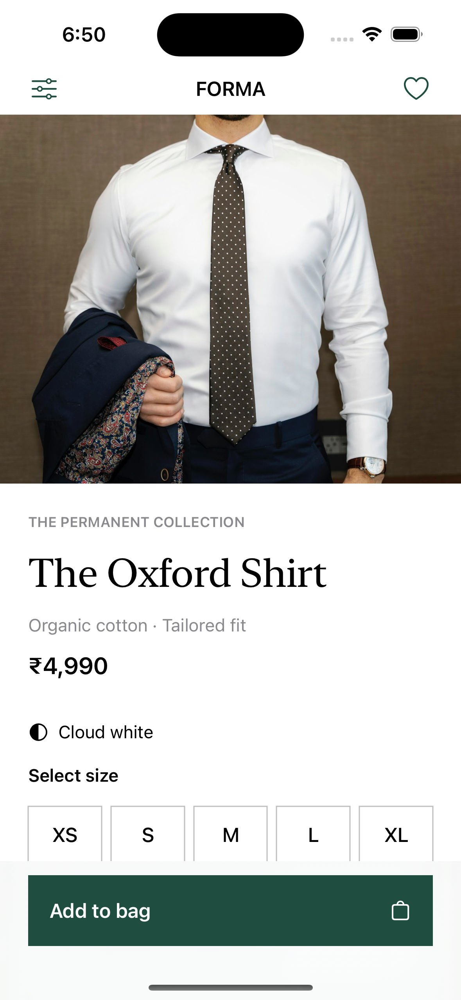

# FORMA / DynamicUI

A native SwiftUI product detail screen demonstrating a registry-based server-driven UI engine. iOS 17+, Xcode 16.2+, Swift 5.10+. No third-party runtime dependencies.

The app renders versioned JSON fixtures for standard, sale, and sold-out products. Use the sliders icon to change scenarios. Select a size, simulate adding to bag, save a favorite, and open the materials sheet. The photo is bundled for repeatable offline demonstrations.



[Recorded Simulator walkthrough](docs/walkthrough.mp4)

## Run

```bash
brew install xcodegen
xcodegen generate
open DynamicUI.xcodeproj
```

Choose the Forma scheme and an iOS Simulator. If Xcode isn't the active developer directory, set `DEVELOPER_DIR` to your Xcode installation. The generated Xcode project is intentionally ignored; `project.yml` is its source of truth.

## Validate

```bash
bash scripts/check-coverage.sh
xcodebuild -project DynamicUI.xcodeproj -scheme Forma \
  -destination 'platform=iOS Simulator,name=iPhone 15 Pro,OS=17.5' \
  -resultBundlePath Validation.xcresult test CODE_SIGNING_ALLOWED=NO
```

Two independent unit coverage gates require greater than 80%: core engine executable lines and the Forma app target. Local results: core 100% (84/84); app 91.37% (381/417) from a unit-only Simulator run. Hosted unit tests launch the app, so some view construction contributes to the app metric. Generated bundle accessors and test sources are excluded. UI tests run separately. See [validation](docs/VALIDATION.md).

## Read

- [Architecture and extension guide](docs/ARCHITECTURE.md)
- [Interview discussion guide](docs/INTERVIEW.md)
- [Validation and release checklist](docs/VALIDATION.md)

## Current boundaries

This is a working portfolio reference, not a connected commerce application. `ScreenSource` is injectable, but the included implementation reads bundled server-contract fixtures. Remote delivery, disk caching, backend cart authorization, analytics, authentication, inventory validation, and actual notification delivery remain integration work. There is no claim of a production deployment.

Photo: [original Unsplash image](https://images.unsplash.com/photo-1598033129183-c4f50c736f10). Product description and pricing are fictional; the photograph is illustrative. Confirm attribution and redistribution details before public release.

Repository: [PranithMargam/DynamicUI](https://github.com/PranithMargam/DynamicUI). The project is published at the repository root so GitHub discovers `.github/workflows/ci.yml`. Generated build artifacts, Xcode user settings, and local test-result bundles are excluded.
