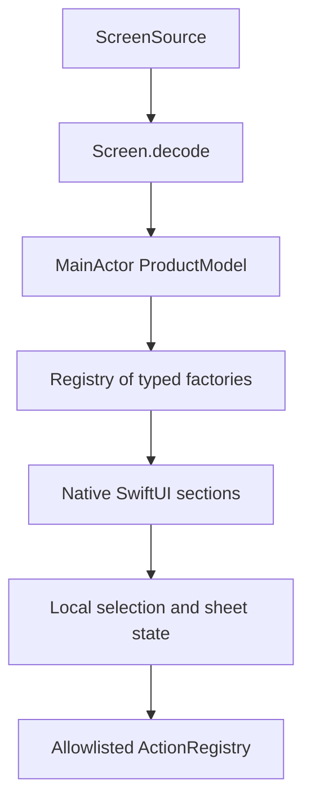

# Architecture

## Ownership

The Swift package owns wire contracts, JSON values, component resolution, fixture sources, and action dispatch. The app owns SwiftUI, composition registration, selected size, favorite state, navigation, and messages. Factories produce type-erased native views only at the composition boundary. JSON cannot execute code or select arbitrary classes or URLs.

`Registry<Output>.register(_:version:props:build:)` couples a typed decoder with its factory. Resolution is a dictionary lookup by type and version. This permits core tests to produce strings without importing SwiftUI. The app uses `RenderedSection` output, containing a view or a purchase placement. The layout policy pins the purchase component below the scroll view. Server component IDs become stable SwiftUI section identities.

The model creates the component registry lazily on first use and retains its setup result for its lifetime. Refresh, retry, and scenario changes reuse the factories while decoding fresh props and constructing fresh sections. Setup errors are cached as well: a duplicate registration is a programming/configuration error, not a transient fetch error. An injectable registry factory supports lifecycle tests. Registration runs on MainActor because the registry belongs to the MainActor-isolated model.

## Contract and failure policy

Screen schema version is 1. Each node requires id, type, version, required, and props. Screens are bounded to 256 KiB and 50 components with nonempty, unique IDs of at most 100 characters. Props decode through Codable into the registered native type. Unknown optional types or versions are skipped. Unknown required components and malformed known components fail the entire screen. This deliberately trades partial rendering for predictable behavior when a known commerce component is corrupt.

Unknown props are tolerated for additive evolution. New required props require a new component version. New native component types require an app release before a server can depend on them. The fixture set is executable contract documentation; a formal JSON Schema and backend contract tests should precede backend integration.

## State and concurrency

ProductModel is MainActor-isolated. Loading preserves the prior composition while fetching, validating, and building a replacement atomically. Size selection resets only when a replacement succeeds. A generation counter prevents an older request from overwriting a newer composition or clearing its loading state. A defer finishes loading on every exit for the current request, including cancellation. Cancellation does not display an error or erase existing content. SwiftUI's scenario-keyed task cancels prior work. Initial errors expose Retry; pull-to-refresh reloads the scenario without replacing existing content with a loading placeholder. Dependencies enter through ScreenSource for deterministic failure and cancellation tests.

## Decisions

- Registry over central switch: independent registration and typed decoding without editing engine dispatch.
- AnyView at the composition boundary: practical heterogeneous view storage; measure performance before expanding to large feeds.
- Flat component schema: sufficient for a PDP and avoids a general recursive layout language.
- Local action allowlist: only compiled handlers can run. Demo cart and notification handlers are simulations.
- Bundled image and fixtures: reliable review without a service account or network.
- No external runtime packages: a small teaching surface and straightforward dependency maintenance.

## Add a component

1. Define a Codable props type in the core (or a feature-owned contract module).
2. Register its name/version and native view factory in the composition root.
3. Add its node to a fixture; preserve stable IDs across revisions.
4. Test props decoding, required/optional compatibility, malformed values, accessibility, and rendering.

## Production integration

Implement ScreenSource with an HTTPS client, request timeouts, cancellation and status validation. Validate payloads before persisting a last-known-good cache. Define a cache freshness policy for prices and inventory; never trust a cached display price for checkout. Cart requests need product/variant identifiers, server authorization, idempotency, and inventory revalidation. Inject an ActionRegistry backed by these services. Add telemetry for revision, unsupported type/version, and sanitized error categories, never personal data. These integrations are intentionally not represented as complete.
